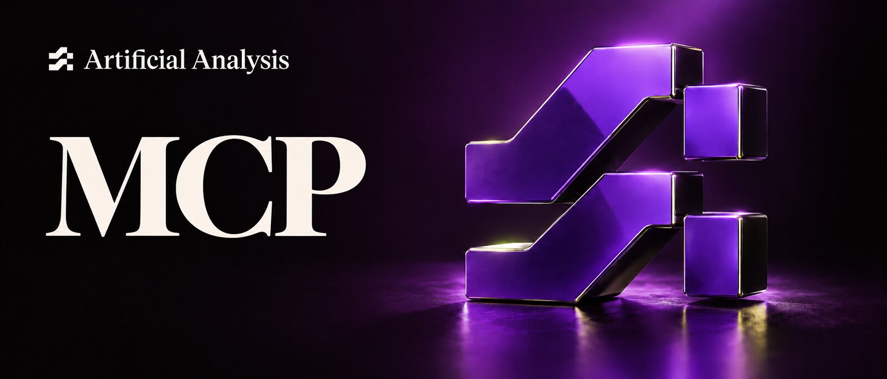

# Artificial Analysis



Ask your assistant about models using [Artificial Analysis](https://artificialanalysis.ai)'s independent benchmarks instead of what it remembers from training.

- **Language models:** the Artificial Analysis Intelligence Index and its evaluations, coding and agentic indexes, context window, price per million tokens, and output speed and time to first token.
- **API providers:** how each provider serves a model on speed, latency and price, with performance over time.
- **Media models:** arena rankings for text-to-image, image editing, text-to-video, image-to-video, text-to-speech, speech-to-text, speech-to-speech and music.

Every tool is read-only.

## Connect

Server URL: `https://mcp.artificialanalysis.ai/mcp` (Streamable HTTP). There's no API key. Add the URL to your client, sign in with your Artificial Analysis account, choose an organization and click **Allow**. Calls count against that organization's API quota, and the data you see follows its plan.

### Claude

In claude.ai or Claude Desktop, go to **Customize > Connectors**, click **+ Add > Add custom connector**, and enter the server URL. In Claude Code:

```sh
claude mcp add --transport http --scope user artificial-analysis https://mcp.artificialanalysis.ai/mcp
```

Then run `/mcp` and sign in.

### ChatGPT

Open [Plugins](https://chatgpt.com/plugins), click **+**, choose **Add custom MCP server**, enter the server URL and choose OAuth.

### Codex

```sh
codex mcp add artificial-analysis --url https://mcp.artificialanalysis.ai/mcp
codex mcp login artificial-analysis
```

### Cursor

Install this plugin from the Cursor Marketplace, or add the server to `~/.cursor/mcp.json`:

```json
{
  "mcpServers": {
    "artificial-analysis": {
      "url": "https://mcp.artificialanalysis.ai/mcp"
    }
  }
}
```

### Gemini CLI

```sh
gemini extensions install https://github.com/ArtificialAnalysis/artificial-analysis-plugin
```

Then run `/mcp auth artificial-analysis` and sign in.

### VS Code

Run **MCP: Add Server**, or add this to `.mcp.json`:

```json
{
  "mcpServers": {
    "artificial-analysis": {
      "type": "http",
      "url": "https://mcp.artificialanalysis.ai/mcp"
    }
  }
}
```

## Try asking

- Which language models lead the Artificial Analysis Intelligence Index right now?
- Which providers serve gpt-oss-120B fastest, and what do they charge?
- What are the top text-to-video models on the Artificial Analysis Video Arena?
- Which models score above 50 on the Intelligence Index for under $1 per million input tokens?

## Tools

| Tool | What it does | Plan |
| --- | --- | --- |
| `aa_language_models_free` | Language models with headline indexes, token prices and median speed | Free |
| `aa_language_models` | Language models with every evaluation, blended prices and percentiles | Pro |
| `aa_language_model` | One language model by slug | Pro |
| `aa_language_model_performance` | A model's performance over 7, 30 or 90 days | Commercial |
| `aa_language_providers` | API providers and the models they serve | Commercial |
| `aa_language_provider` | One API provider by slug | Commercial |
| `aa_language_provider_performance` | A provider's performance over 7, 30 or 90 days | Commercial |
| `aa_language_provider_measurements` | A provider's raw measurements | Commercial |
| `aa_media_rankings_free` | Arena Elo rankings for image, video, speech and music models | Free |
| `aa_media_rankings` | Arena rankings with rank, samples, pricing and categories | Pro |
| `artificial_analysis_help` | Usage, and the plan each tool needs | Any |
| `aa_api_context`, `aa_describe_endpoint`, `aa_describe_fields`, `aa_describe_schema` | Explain the API and its fields, without using quota | Any |

## Troubleshooting

| Symptom | Fix |
| --- | --- |
| Asked to sign in again every hour | Your client didn't request `offline_access`, so it has no refresh token. Reconnect, or update the client. |
| `401 invalid_token` with an API key configured | The server takes OAuth sign-in only. Remove the `Authorization` header so the client signs in. |

## Privacy and support

The server sends only the endpoint and query your assistant chooses to the Artificial Analysis API, and keeps no conversation content. See the [privacy policy](https://artificialanalysis.ai/privacy-policy) and [terms of use](https://artificialanalysis.ai/terms-of-use). For help, email [support@artificialanalysis.ai](mailto:support@artificialanalysis.ai).
